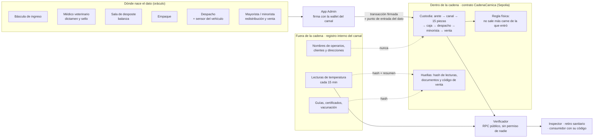

# Láminas para el jurado · Reto 04 · Nivel 1

Contenido de las dos láminas que pide el brief (entregables 3 y 4). La versión visual está en
`docs/laminas.html`.

---

## Lámina 1 · Arquitectura: qué vive dentro de la cadena, qué fuera y dónde entra el dato

**Dentro de la cadena** (solo números, códigos seudónimos y huellas):
- Ingreso del animal: arete, código de predio, fecha, peso vivo, dictamen ante-mortem, código del veterinario, huella de los documentos.
- Canal: vínculo arete ↔ canal, peso caliente, dictamen post-mortem, sello, hora y curva de 5 temperaturas.
- Desposte: las 15 piezas con peso y operario, más el balance de masa de la canal (±2 %).
- Caja: corte, máscara de canales de origen, peso, fecha real de empaque, operario. La molida va marcada como **mezcla de lote**.
- Despacho: cliente, cajas, y un resumen de frío (máxima, minutos fuera de rango, minutos sin lectura, huella de las lecturas).
- Redistribución al minorista y venta (huella del código de consulta → caja).

**Fuera de la cadena:** nombres de personas y clientes, direcciones, nombres de predios, lecturas
individuales de temperatura y documentos originales. Solo su huella está en la cadena: si alguien los
cambia, la huella deja de coincidir.

**Dónde entra el dato:** en la transacción que firma la wallet del camal. Desde ese instante el registro
no se puede cambiar ni borrar. Lo que no se puede garantizar es que el dato tecleado fuera verdadero
(ver lámina 2).

**Por qué la división y la mezcla no rompen el modelo:** la caja no apunta a un animal sino a un conjunto
de piezas (muchos a muchos), y la carne molida apunta al lote. La consulta hacia adelante devuelve las
cajas directas de la canal y, aparte, toda la mezcla del lote.

---

## Lámina 2 · Honestidad: supuestos, limitaciones, costo y lo que no resolvemos

### Lo que sí resuelve
- **No se puede reescribir la historia.** Kilos que aparecen después, una caja despachada dos veces o
  lecturas de frío borradas se detectan porque el registro original es inmutable.
- **La regla física la hace cumplir el contrato**, no quien registra: las 6 cajas de lomo fino sin
  piezas no entran (juntas serían 278 kg contra un tope de 205 kg).
- **El retiro hacia adelante es una sola consulta**, que puede hacer cualquiera sin pedir permiso.

### Lo que no resuelve (el problema del oráculo)
- Si la balanza marca mal, si el operario teclea un peso falso o si el veterinario sella sin mirar, **la
  cadena guarda la mentira con total fidelidad**. Solo hace que esa mentira sea permanente y atribuible.
- Las lecturas de temperatura las firma la wallet del camal, no el sensor. Un sensor que firme sus
  propias lecturas es el Nivel 3, y no está implementado.
- El contrato **no** bloquea animales sin vacuna vigente ni canales selladas por un veterinario fuera de
  turno: lo registra, no lo impide (habilitación en origen = Nivel 3). Tampoco detecta las ventas
  posteriores al retiro (retiro automático = Nivel 3).

### Supuestos y limitaciones del prototipo
- **Carga retroactiva:** los datos de agosto se cargaron en octubre. Cada registro guarda la fecha real
  del evento, pero la hora del bloque es la de la carga. En producción se anclaría cuando ocurre cada traspaso.
- **Sin control de acceso por rol:** cualquier wallet puede escribir en el contrato. En producción, solo
  los actores autorizados.
- **Un contrato por lote** (constantes del lote LF-2026-0188). Para operar se necesita un registro multilote.
- **Tolerancias redondeadas:** el ±2 % y los rendimientos de referencia vienen del manual del ejercicio,
  no de una norma real.
- **Seudónimos enlazables:** `OP-21` o `CL-R05` no son nombres, pero quien tenga la tabla interna puede
  vincularlos. El código de consulta tiene poca entropía: su huella podría adivinarse probando valores.
- **La molida obliga a retirar todo el lote:** es lo honesto, porque la mezcla no puede separarse por animal.

### Costo anual estimado (camal de 300 reses por semana)

Medido en el prototipo: el lote completo (55 canales despostadas, 364 cajas, 12 despachos, 264 ventas)
consumió **57,98 M de gas**, unos **1,05 M de gas por res**.

| Escenario | Gas por año | Costo |
|---|---|---|
| Todo el detalle en una red pública (como el prototipo) | 300 × 52 × 1,05 M ≈ **16 400 M** | 16,4 ETH/año a 1 gwei · 164 ETH/año a 10 gwei |
| **Recomendado:** detalle en una red permisionada (camal, ANSA, mayoristas, municipio) + anclaje diario de una raíz Merkle en red pública | ≈ 22 M (365 anclajes × 60 k) | 0,02–0,22 ETH/año de anclaje (1–10 gwei) + servidores de 4 nodos |

Para pasar a dólares: ETH/año × precio del ETH el día de la presentación. Los servidores de la red
permisionada son un supuesto de orden de magnitud, del rango de unos pocos miles de USD al año. Volumen
fuera de la cadena: unas 576 lecturas de cámara y 95 de transporte por lote; decenas de miles por semana,
que solo dejan su huella en la cadena.

### Adopción
- **Tercena sin conectividad:** no necesita lector especial; el código va impreso en la etiqueta. La
  venta se registra cuando hay conexión y la verificación la hace el consumidor desde su teléfono.
- **Integración con la planta:** el cargador lee una exportación del sistema existente (SITRAC). No
  reemplaza el sistema: ancla lo que ese sistema ya registra.

### Qué sigue sin resolverse
- El dato falso en origen (oráculo): sensores y balanzas que firmen, y credenciales verificables de la autoridad sanitaria.
- La garantía de que todo se anclaría en tiempo real (hoy depende de que el camal envíe la transacción).
- La gobernanza de la red permisionada: quién opera los nodos y quién autoriza a cada actor.
